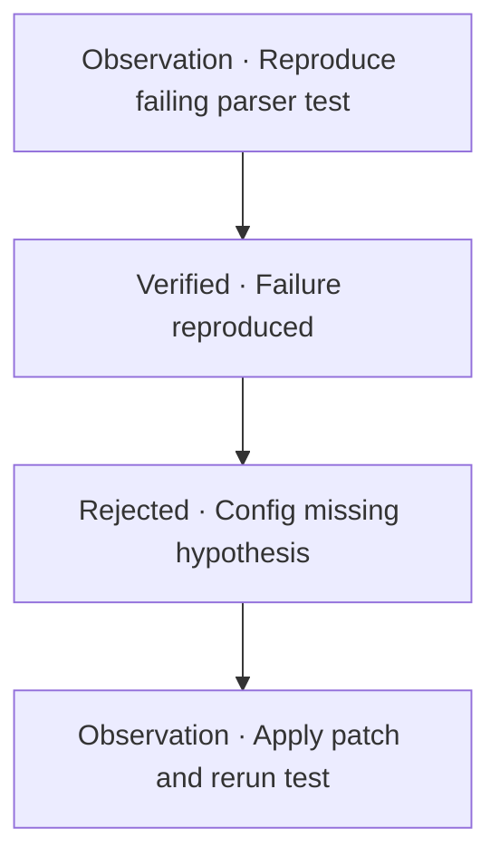

# Phase U — Context-Offload Prototype Design

**Status:** Design (not implementation)
**Phase:** U (following Phase T pattern extraction)
**Created:** 2026-07-11
**Reviewers:** ChatGPT co-development session (conversation `6a529d53`)

---

## 0. Purpose

Phase U designs Moneta's context-offload subsystem: how tool-heavy coding-agent
sessions preserve raw evidence in durable, hashed, human-readable refs while
keeping active context compact.

This is a **design document**, not an implementation. No production code changes,
no runtime hook patches, no retrieval behavior changes occur in Phase U.

### Origin

Phase T extracted the context-offload pattern from TencentDB-Agent-Memory.
The useful insight is not TencentDB's retrieval (hybrid/RRF — blocked by E4), but
its evidence-preserving layered drill-down: raw tool outputs at the bottom,
compact task canvas at the top, with a deterministic path between them.

### Non-goals (hard constraints)

```
no retrieval default change
no dense/fusion
no Evidence-RRF tuning
no production hook patching
no corpus mutation unless E1/E2 run
no automatic compression without raw refs
no automatic L3 memory creation from offloaded tasks
```

### Acceptance bar

Phase U is complete when this document answers:

```
Where does raw tool output go?
How is each ref hashed?
How does a canvas node point back to raw evidence?
How are stale refs retired?
How does E1 verify offload artifacts?
How does this avoid changing retrieval behavior?
```

---

## 1. U0 — Target Workload

### Definition

The Phase U prototype targets a **single-agent, single-repository diagnostic
task** whose initial failure and final outcome can be expressed as executable
commands with captured exit status.

The prototype ends before automatic L3 memory creation.

### Qualifying session

A qualifying prototype session contains:

1. A failing test, build, lint, type-check, or runtime reproduction
2. Multiple high-volume tool results
3. At least one hypothesis that is revised or rejected
4. A code or configuration change
5. A final verification command
6. A small set of task-state claims supported by captured evidence

### Example session

```
npm test
  → 8,000-line failure output

rg / repository inspection
  → candidate implementation locations

targeted test
  → reproduces one failure

patch
  → modifies two files

targeted test + full suite
  → verifies repair
```

### Excluded from first prototype

```
open-ended codebase exploration
greenfield implementation
multi-repository changes
remote deployment debugging
interactive debuggers
long-running processes and streaming logs
binary traces, videos, or screenshots
multiple concurrent agents
automatic conversion into L3 memories
```

These cases introduce different capture, lifecycle, and authority problems.

---

## 2. U1 — File Layout

### Directory structure

```
.moneta/offload/
├── refs/
│   └── <observation_id>/
│       ├── manifest.json       ← observation provenance + artifact digests
│       ├── stdout.log          ← raw captured stdout (exact bytes)
│       ├── stderr.log          ← raw captured stderr (exact bytes)
│       └── result.json         ← structured result if applicable
├── state/
│   └── task-state.json         ← canonical task state (authoritative)
├── canvases/
│   └── task-canvas.mmd         ← Mermaid projection (generated, disposable)
└── events/
    └── audit.jsonl             ← lifecycle events (append-only)
```

### Design rationale

**Observation-oriented, not content-addressed.** Refs are grouped by the tool
invocation that produced them, not by SHA-256 hash sharding. This makes the
offload directory browsable by humans (each directory = one tool call with its
outputs and manifest inside).

SHA-256 establishes artifact identity and integrity through the manifest, but
does not determine physical file placement. Content-addressed storage and
deduplication are deferred to a future production design.

**Trade-off acknowledged:** identical artifacts from different observations are
stored as separate files. Dedup is a production concern, not a prototype concern.

### Path safety

`observation_id` values are ASCII-safe (prefixed ULID). No user-provided strings
appear in directory names. Human-readable descriptions live in manifest labels,
not in the filesystem.

---

## 3. U2 — Identity and Ref Schema

### Three identities, never conflated

| Identity | Purpose | Format |
|---|---|---|
| `ref_id` | Content identity (what bytes) | `sha256:<64-lowercase-hex>` |
| `observation_id` | Invocation identity (which tool call) | `obs_<ULID>` (opaque) |
| `claim_id` | Task-local claim identity | `C01`, `C02`, ... (stable within task) |
| `task_id` | Task identity | `task_<ULID>` (opaque) |

**Identity vs label rule:** Human-readable names are labels stored in the
manifest, never authoritative identifiers. Labels change and collide;
content-addressed digests do not.

### `observation_id` format

```
obs_01J2A6M8K4SG5DV1P0QXHNRYK
```

Opaque prefixed ULID (26 chars, lexicographically sortable by time, no semantic
content). The manifest carries all capture metadata (`started_at`, `tool`,
`command`, etc.).

**Integrity rule:** The ULID timestamp is not authoritative capture metadata and
does not define logical task order. Three separate concepts:

- `started_at` (in manifest) defines capture time
- The ordered `trace` array defines canvas/presentation order
- ULID lexicographic ordering is for storage/reconstruction convenience only

E1 must not derive or validate `started_at` from the ULID component.

### Observation manifest

```json
{
  "schema_version": "moneta.offload.observation.v1",
  "observation_id": "obs_01J2A6M8K4SG5DV1P0QXHNRYK",
  "task_id": "task_01J2A5ZP7FNGHE0C9M4XRTBLQ",
  "capture": {
    "tool": "shell",
    "command": "npm test",
    "cwd": ".",
    "exit_code": 1,
    "started_at": "2026-07-11T19:42:33.117Z",
    "finished_at": "2026-07-11T19:42:48.902Z",
    "stdout_stderr_mode": "separate"
  },
  "repository_context": {
    "root": "/abs/path/to/repo",
    "head_commit": "abc1234",
    "branch": "main",
    "dirty": true
  },
  "artifacts": [
    {
      "ref_id": "sha256:5c9f6f85f1e7a3b2c8d4e5f6a7b8c9d0e1f2a3b4c5d6e7f8a9b0c1d2e3f4a5b6",
      "relative_path": "stdout.log",
      "media_type": "text/plain",
      "encoding": "utf-8",
      "byte_length": 184203
    },
    {
      "ref_id": "sha256:a81d2c74e3f5b6a7c8d9e0f1a2b3c4d5e6f7a8b9c0d1e2f3a4b5c6d7e8f9a0b1",
      "relative_path": "stderr.log",
      "media_type": "text/plain",
      "encoding": "utf-8",
      "byte_length": 4021
    }
  ],
  "integrity": {
    "capture_complete": true,
    "truncated": false,
    "transformed": false
  },
  "presentation": {
    "label": "full npm test failure before parser fix",
    "suggested_filename": "npm-test-before-fix"
  },
  "lifecycle": {
    "status": "active",
    "created_at": "2026-07-11T19:42:49.011Z",
    "retired_at": null,
    "retirement_reason": null
  }
}
```

### `result_ref` object (evidence pointer)

Claims point to evidence through structured result_refs, not bare digest strings:

```json
{
  "observation_id": "obs_01J2A6M8K4SG5DV1P0QXHNRYK",
  "ref_id": "sha256:5c9f6f85f1e7...",
  "selector": {
    "type": "line_range",
    "start": 418,
    "end": 447
  },
  "role": "supports",
  "label": "stack trace showing null parser state"
}
```

### Role vocabulary

```
supports       — evidence substantiates the claim
contradicts    — evidence refutes the claim
context        — relevant background, not direct proof
produced_by    — this observation produced this artifact
verified_by    — this observation verifies a prior claim
supersedes     — replaces a prior ref
derived_from   — this ref was derived from another (transformed)
```

Evidence relationships must not all mean "supports." A failed hypothesis needs a
`contradicts` ref. A diff is `produced_by`, not proof that a fix works.

### Selector types (Phase U: two only)

```
whole          — entire artifact
line_range     — lines start..end (inclusive)
```

Because refs are immutable, line selectors remain stable. `json_pointer` and
`byte_range` are deferred.

**Selector validity rule:** A selector applies to one exact `ref_id`, never
implicitly to its parent or derivative. Line numbers in a redacted or
ANSI-stripped derivative may differ from the raw artifact. E1 rejects selectors
whose bounds do not exist in the specifically cited artifact.

### Resolution rule: evidence refs must carry observation_id

Because `ref_id` does not determine file path (observation-oriented storage),
a bare digest is insufficient for physical resolution. Every evidence reference
must carry both `observation_id` and `ref_id`. The observation manifest then maps
`ref_id` to `relative_path`. A global ref-to-path index may remain deferred for
Phase U — the observation_id in each result_ref is the resolution key.

### Critical rule: transformed output becomes a new ref

If Moneta strips ANSI, redacts secrets, converts encoding, truncates content,
combines streams, or extracts excerpts, the result is a **new artifact** with a
new digest:

```json
{
  "ref_id": "sha256:different...",
  "derived_from": ["sha256:original..."],
  "transformation": {
    "name": "strip-ansi",
    "version": "1"
  }
}
```

Never silently hash transformed content while implying it is the raw capture.

---

## 4. U3 — Task Canvas Format

### Two-file design

```
state/task-state.json     ← canonical, authoritative, machine-queryable
canvases/task-canvas.mmd  ← deterministic Mermaid projection, disposable
```

`task-state.json` is the source of truth. `task-canvas.mmd` is generated from it
and byte-compared during verification.

### Why Mermaid is a projection, not the store

Mermaid is good for the visible canvas: plain text, diffable, compact,
human-readable, renderable in many environments.

But Mermaid is a poor canonical database: parsing is hard, labels can corrupt
diagrams, renderer versions differ, graph layout is not semantic state.

### Canonical task state

```json
{
  "schema_version": "moneta.offload.task-state.v1",
  "task_id": "task_01J2A5ZP7FNGHE0C9M4XRTBLQ",
  "revision": 4,
  "status": "active",
  "created_at": "2026-07-11T19:42:00.000Z",
  "updated_at": "2026-07-11T20:15:33.000Z",
  "observations": [
    {
      "observation_id": "obs_01J2A6M8K4SG5DV1P0QXHNRYK",
      "role": "reproduction"
    },
    {
      "observation_id": "obs_01J2A7R1Y9TGBH2D5N6YUSCMW",
      "role": "verification"
    }
  ],
  "claims": [
    {
      "claim_id": "C01",
      "status": "verified",
      "assertion": "The targeted parser test fails before the patch.",
      "claim_type": "command_outcome",
      "derivation": {
        "type": "exit_code_not_equals",
        "observation_id": "obs_01J2A6M8K4SG5DV1P0QXHNRYK",
        "expected": 0
      },
      "evidence_refs": [
        {
          "observation_id": "obs_01J2A6M8K4SG5DV1P0QXHNRYK",
          "ref_id": "sha256:5c9f6f85f1e7...",
          "selector": {
            "type": "line_range",
            "start": 418,
            "end": 447
          },
          "role": "supports",
          "label": "stack trace showing null parser state"
        }
      ]
    },
    {
      "claim_id": "C02",
      "status": "rejected",
      "assertion": "The parser fails because configuration is missing.",
      "claim_type": "hypothesis",
      "evidence_refs": []
    }
  ],
  "trace": [
    { "type": "observation", "id": "obs_01J2A6M8K4SG5DV1P0QXHNRYK" },
    { "type": "claim", "id": "C01" },
    { "type": "claim", "id": "C02" },
    { "type": "observation", "id": "obs_01J2A7R1Y9TGBH2D5N6YUSCMW" }
  ]
}
```

### Claim status values

```
proposed    — asserted, not yet checked
verified    — derivation confirmed against evidence (mechanically derived)
rejected    — hypothesis contradicted or abandoned
superseded  — replaced by a later claim
```

**`verified` means mechanically derived**, not "a human wrote an assertion and
attached a plausible log." A claim receives `verified` only when its declared
derivation succeeds against the referenced observation metadata or artifact.

For judgment claims that cannot be mechanically derived (e.g., "the design is
cleaner"), use:
```
claim_type: non_derivable
verification_mode: manual
status: proposed
```

These are explicitly excluded from `verified` status.

### Ordered trace

The `trace` array is a **presentation sequence**, not a graph. It defines how
the task unfolded and how the Mermaid canvas should order nodes.

Without it, the renderer must guess whether to order by observation timestamp,
claim array position, or evidence linkage — these produce different canvases.

### Generated Mermaid (restricted dialect)



### Moneta canvas profile (restricted Mermaid dialect)

```
diagram type:   flowchart TD only
node IDs:       ASCII only (O01, C01, ...)
labels:         supplied through node aliases
max label len:  72 characters
no user-provided Mermaid directives
no arbitrary styling
no embedded HTML
no external links as evidence authority
deterministic node and edge ordering (follows trace array)
```

### Projection integrity (byte-for-byte)

The Mermaid canvas is verified by byte-for-byte comparison, not just syntax
validation:

```
task-state.json
  → deterministic generator (fixed ordering, escaping, LF line endings)
  → regenerated task-canvas.mmd
  → byte-for-byte comparison with stored task-canvas.mmd
```

Deterministic generation requires: fixed node ordering (follows trace array),
fixed edge ordering, consistent label escaping, and LF line endings. Two
semantically similar canvases that differ by whitespace or ordering fail
verification. This prevents canvas drift from canonical state.

### Do not place raw ref URIs in node labels

A 64-character digest destroys canvas readability. Display:
```
1 evidence ref
```
The full mapping lives in `task-state.json`.

---

## 5. U4 — Lifecycle and Audit Events

### Ref lifecycle states

```
active → retired → collection-eligible → deleted
```

- **active:** referenced by current task canvas
- **retired:** not active for current task, but may support old claims/audit
- **collection-eligible:** zero inbound references, retention period expired, not quarantined
- **deleted:** physically removed after retention policy

**Retirement ≠ deletion.** Retirement is a relevance decision. Deletion is a
reference-and-retention decision.

A retired ref becomes collection-eligible only when:
- it has no protected inbound claim or task-state references
- its retention period has expired
- it is not quarantined or under an audit/security hold

**Deletion tombstone.** Physical deletion erases raw bytes but must not erase
proof that the artifact existed. The retained audit record retains:

```
ref_id
observation_id
original relative path
byte length
media type
created_at
deleted_at
deletion reason
authorizing event or policy
```

The raw bytes disappear; their identity and lifecycle history do not.

### Task lifecycle states

```
active → completed | abandoned
```

### Audit events (append-only JSONL)

```jsonl
{"event":"observation_captured","observation_id":"obs_01J2...","task_id":"task_01J2...","timestamp":"2026-07-11T19:42:49.011Z"}
{"event":"claim_proposed","claim_id":"C01","task_id":"task_01J2...","timestamp":"2026-07-11T19:43:00.000Z"}
{"event":"claim_verified","claim_id":"C01","derivation":"exit_code_not_equals","timestamp":"2026-07-11T19:43:05.000Z"}
{"event":"claim_rejected","claim_id":"C02","task_id":"task_01J2...","timestamp":"2026-07-11T19:50:00.000Z"}
{"event":"ref_retired","ref_id":"sha256:5c9f...","reason":"superseded_by_patch","timestamp":"2026-07-11T20:00:00.000Z"}
{"event":"task_completed","task_id":"task_01J2...","timestamp":"2026-07-11T20:15:33.000Z"}
```

### Atomic write protocol

A ref is not valid until both the artifact and the committed manifest exist.

```
1. write to temporary file (stdout.log.tmp)
2. flush
3. compute SHA-256 of exact stored bytes
4. atomically rename to final path
5. write/append manifest
6. append audit event
```

A crash between steps 1-4 leaves an orphaned temp file, not a broken ref. A crash
between 4-5 leaves a valid artifact without a manifest. A crash between 5-6
leaves a committed artifact without a creation event.

**Crash recovery rule:** Unmanifested files and manifests without matching
creation events are integrity failures or explicitly classified recoverable
orphans. They are never silently treated as valid refs. The verifier detects:
artifact-without-manifest (orphan artifact), manifest-without-artifact (dangling
manifest), and manifest-without-audit-event (uncommitted ref). Each has a defined
recovery action, not silent acceptance.

---

## 6. U5 — E1 Verifier Integration

E1 should verify five distinct properties of offload artifacts.

### 1. Referential integrity

- Every cited `observation_id`, `claim_id`, and `ref_id` exists
- Every selector is valid for the referenced artifact (line_range doesn't exceed file length)
- Selectors are validated against the specifically cited `ref_id`, not an implicit parent/derivative
- No active claim depends on a deleted ref
- No orphaned artifacts (artifact without manifest), dangling manifests (manifest without artifact), or uncommitted refs (manifest without audit event)

### 2. Content integrity

- Recompute SHA-256 from stored bytes
- Confirm manifest digest matches computed digest
- Confirm byte_length matches
- Confirm derivative chains (derived_from) terminate in an available raw capture or explicitly documented unavailable source

### 3. Projection integrity

- Validate `task-state.json` schema
- Regenerate `task-canvas.mmd` from task state
- Compare generated output byte-for-byte with stored canvas
- Reject unsupported Mermaid constructs (anything outside the restricted dialect)

### 4. Claim integrity

For each verifiable claim, E1 computes the derivation from the observation
record and compares with the assertion:

```json
{
  "claim_id": "C05",
  "assertion": "The targeted parser test passes after the patch.",
  "claim_type": "command_outcome",
  "derivation": {
    "type": "exit_code_equals",
    "observation_id": "obs_01J2A7R1Y9...",
    "expected": 0
  }
}
```

E1 reads the observation manifest's `exit_code`, compares to `expected`, and
sets claim status to `verified` or `rejected`.

This preserves Phase E's principle: **derive from artifacts, don't trust
hand-written expected values.**

Non-verifiable claims ("the design is cleaner") are marked
`claim_type: subjective` and skipped — not dressed up as evidence-derived facts.

### 5. Lifecycle integrity

- Retirement events have reasons
- Deleted refs have zero inbound references
- State transitions follow allowed lifecycle
- Event order is monotonic (no events before task creation)
- Revision numbers are sequential

### Verifier status types (consistent with Phase E)

```
pass               — extracted value matches computed value
fail               — extracted value does NOT match
extraction_failed  — regex/schema did not match (manual review needed)
```

---

## 7. U6 — No-Retrieval-Change Gate

The gate is stronger than "we did not edit `rankByBlendedScore`."

### Isolation invariants

1. `.moneta/offload/**` is not a memory corpus source
2. Offload creation does not call `remember`, `reinforce`, consolidate, or alter strength
3. Offload artifacts do not appear as lexical candidates in any retrieval call
4. No offload metadata is added to existing memory bodies
5. Ranking results for the fixed E2 query set are byte-identical before and after representative offload activity
6. Active/tombstoned memory counts are unchanged
7. Memory event logs contain no corpus mutation caused by offload operations
8. Offload refs are exposed through a distinct resource or explicit drill-down path, never through retrieval fallback

### Verification shape

```
snapshot corpus + E2 rankings
  → create representative Phase U task/ref/canvas artifacts
  → rerun corpus counts + E2 rankings
  → require exact identity
```

This is an **isolation gate**, not a relevance-quality gate. It compares outputs,
not merely code paths. The check requires:

```
identical corpus counts (active, tombstoned)
no new memory events caused by offload operations
identical candidate IDs and ordering for the E2 fixture queries
identical ranking scores where serialization is stable
zero offload artifacts appearing as retrieval candidates
```

"Retrieval code was not modified" is supporting evidence, not the gate itself.

### Architectural separation

The offload subsystem must have its own:
- storage path (`.moneta/offload/`)
- schemas (observation, task-state, audit)
- lifecycle (active/retired/deleted)
- access path (drill-down API, not retrieval)

No offload file may be readable by the memory corpus indexer, the lexical
retrieval candidate generator, or the dense/fusion experimental code.

---

## 8. Drill-Down Chain (Summary)

The complete path from a memory claim to raw evidence:

```
claim_id (in task-state.json)
  → evidence_refs[] (structured result_ref objects)
    → observation_id → observation manifest
      → ref_id (sha256) → relative_path
        → raw bytes (stdout.log / stderr.log)
```

Claims may also link directly to result_refs without going through canvas nodes.
The canvas is for human consumption; the structured state carries truth.

### Future MCP exposure

A future implementation can expose refs as MCP resources:

```
moneta://offload/tasks/<task_id>/observations/<observation_id>/refs/sha256:<digest>
```

The filesystem digest remains authoritative; the MCP URI is an access address.
Raw refs are **untrusted evidence** — drill-down APIs label their content as
untrusted tool output and avoid automatically injecting entire refs into agent
context (prevents prompt injection via repo content).

---

## 9. Failure Modes and Design Responses

| ID | Failure mode | Design response |
|---|---|---|
| A | Canvas becomes second source of truth | JSON state is authoritative; verifier regenerates Mermaid and byte-compares |
| B | Evidence laundering (cited log doesn't substantiate claim) | Require selectors + relationship roles for factual claims; "ref exists" is not sufficient |
| C | Capture incomplete but appears authoritative | Every ref records capture_complete, truncated, stream handling, exit status, byte count |
| D | Hash semantics ambiguous | Digest exact stored bytes; every transformation creates a derivative ref |
| E | Secrets become durable evidence | Secret-bearing captures are **refused before persistence** or placed in **separately access-controlled quarantine**; the ordinary refs/ directory receives only the redacted derivative. Unredacted artifacts must never remain in the normal offload store merely because a redacted derivative also exists |
| F | Raw output as prompt-injection channel | Raw refs are untrusted evidence, not instructions; drill-down APIs label content as untrusted |
| G | Retirement mistaken for deletion | Retirement = "not active for current task"; deletion requires zero inbound refs + retention eligibility |
| H | Storage grows without bound | active → retired → collection-eligible → deleted; GC is reference-aware and auditable |
| I | Partial writes create broken refs | Write to temp, flush, hash, atomically rename, then commit manifest; ref invalid until both exist |
| J | Concurrent agents overwrite state | revision + previous-state digest in every update; reject lost updates |
| K | Repository identity underspecified | Observation metadata includes root, HEAD commit, branch, dirty-state |
| L | Non-deterministic verification overstated | Distinguish observed_pass / repeated_pass / suite_pass / claim_verified |
| M | Canvas staleness misleads | Include task revision, generated_at, source-state digest; canvas whose digest mismatches fails verification |
| N | Offload artifacts leak into retrieval | U6 establishes architectural separation, not just "code was unchanged" |

---

## 10. Deferred Beyond Phase U

```
content-addressed filesystem placement (CAS sharding)
deduplication
node/edge graph model
typed causal relationships
cross-task relationships
automatic L3 memory creation from offloaded tasks
secrets redaction pipeline (design choice required before implementation)
garbage collection implementation
concurrent multi-agent task state
interactive debugger capture
streaming log capture
```

---

## 11. Phase U Scope Statement

Phase U is designing the **minimum viable evidence-preserving offload** for a
single diagnostic coding task, while writing down only the invariants that a
later production design must not violate.

The design preserves:
- Immutable raw evidence (exact-byte SHA-256)
- Three-identity separation (ref_id / observation_id / claim_id)
- Structured evidence references with selectors and roles
- Deterministic Mermaid projection from canonical JSON state
- Lifecycle with retirement ≠ deletion
- E1 verifier integration (referential, content, projection, claim, lifecycle)
- Retrieval isolation (U6 gate)

It does not implement any of the above. It does not touch production retrieval,
corpus, hooks, or memory mutation.

---

## Co-development record

This design was developed in collaboration with ChatGPT (Moneta project,
conversation `6a529d53`). Three simplifications were debated and adopted:

1. **Directory layout:** observation-oriented (not CAS-sharded) — simpler for
   prototype scale, deferred dedup
2. **observation_id:** pure ULID (no embedded timestamp) — avoids denormalization
3. **task-state.json:** observations + claims + trace (not full node/edge graph)
   — minimum viable for Phase U

ChatGPT added three elements the design retains:
- Structured evidence refs (not bare digest strings)
- Claim status (proposed/verified/rejected/superseded)
- Ordered trace array (presentation sequence for Mermaid generation)
